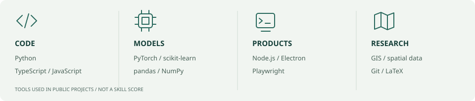
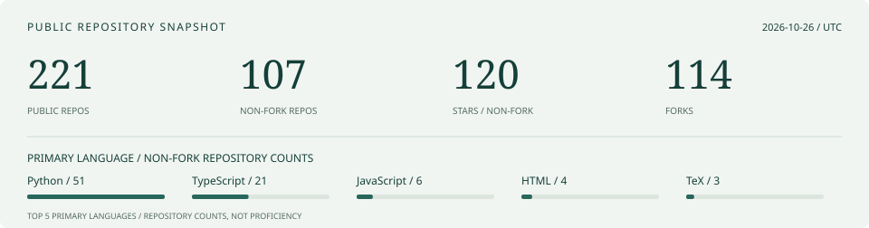

  

  
  

  <a href="https://github.com/sjkncs?tab=repositories">Repositories / 代码</a> ·
  <a href="https://orcid.org/0009-0001-7693-6484">ORCID / 研究</a> ·
  <a href="https://sjkncs.github.io/my-hexo-blog/">Blog / 博客</a> ·
  <a href="mailto:zhiwaisong@gmail.com">Email / 联系</a>

##  About / 关于我

I'm **Yangting SONG**, based in Shenzhen, at **Harbin Institute of Technology (Shenzhen)**. I build AI tools and agent workflows, and work with mathematical modeling, scientific computing and spatial data. My public repositories bring together software engineering, research tooling and applied projects.

我是 **Yangting SONG（sjkncs）**，来自**哈尔滨工业大学（深圳）**。关注 AI 工具与智能体工作流、数学建模与科学计算，以及空间数据与城市研究；希望把方法、数据处理和可运行的软件连接起来。

##  Focus / 近期方向

| Direction | 正在推进的工作 |
| :--- | :--- |
| AI agents & developer tools | 智能体运行时、模型与工具集成、插件机制，以及浏览器与桌面自动化。 |
| Research workflows | 文献整理、实验记录、论文与图表工具，保留来源和可复现入口。 |
| Urban & spatial computing | 深圳住房更新、GIS 与可达性、文旅数据分析；区分数据覆盖、描述分析与因果证据。 |

Longer-term interests include optimization, machine learning, quantitative analysis and environmental AI. / 长期兴趣包括优化理论、机器学习、量化分析与环境 AI。

##  Selected work / 项目精选

These are entry points into my public work; project READMEs document their setup and limitations. / 以下是公开项目的入口，使用方式和当前边界以各仓库说明为准。

| Project | What you can explore / 内容 | Stack |
| :--- | :--- | :--- |
| [AgentX](https://github.com/sjkncs/agentx) | AI coding agent harness with model integration, plugins and data-task workflows。AI 编程智能体与数据任务工作台。 | TypeScript · Node.js |
| [dsh-research](https://github.com/sjkncs/dsh-research) | Research presets, plugins and a desktop wrapper around DeepSeek Harness。科研模式、工作台与桌面包装。 | TypeScript · Electron |
| [Shenzhen housing redevelopment](https://github.com/sjkncs/shenzhen-housing-redevelopment) | Citywide data coverage, a Luohu case study, spatial audits and event-study diagnostics。住房更新的数据与空间核验；项目红线因果识别仍有待完成。 | Python · GIS |
| [GUI Agent Framework](https://github.com/sjkncs/gui-agent-framework) | Modular browser/desktop pipelines with vision, planning and human intervention。模块化 GUI 自动化与人工介入流程。 | Python · Playwright |
| [Bilibili AI learning index](https://github.com/sjkncs/bili-ai-index) | Source-linked indexes for paper readings, courses, interviews and 3D vision。按内容分类的 AI 学习资源索引，保留原始来源。 | Markdown · Metadata |
| [Ding-AI](https://github.com/sjkncs/Ding-AI) | LLM-assisted presentation generation for web and desktop。AI 辅助演示文稿生成工具。 | TypeScript · Electron |

More projects / 更多项目

- [SmartTravel Qingyuan](https://github.com/sjkncs/smarttravel-qingyuan): rural tourism platform with RAG and desktop support / 乡村旅游与知识库问答。
- [Guishan Island tourism](https://github.com/sjkncs/guishan-island-tourism): multi-platform NLP and visitor analysis / 桂山岛文旅数据分析。
- [PandaQuantFlow](https://github.com/sjkncs/PandaQuantFlow): quantitative factor research / 量化因子研究工具。
- [EIC shipping data processing](https://github.com/sjkncs/EIC-shipping-data-processing): historical OCR correction and data cleaning / 历史航海记录校正。
- [AI papers and notes](https://github.com/sjkncs/ai-papers-and-notes): paper reviews and learning notes / AI 论文研读与笔记。
- [Paper plot skills](https://github.com/sjkncs/paper-plot-skills): figure tools for research workflows / 科研图表工具。

##  Toolkit / 常用工具

  
  
  
  
  
  
  
  

  

Applied across these projects / 用于上述项目：**Python · TypeScript · JavaScript · PyTorch · pandas · scikit-learn · Node.js · Electron · Playwright · GIS · Git · LaTeX**.

##  Public activity / 公开仓库动态

  

<!-- activity:start -->

Public GitHub metadata, collected **2026-10-14 (UTC)**. / 公开数据快照，每日尝试同步。

| Metric / 指标 | Value / 数值 |
| :--- | ---: |
| Public repositories / 公开仓库（含 fork） | 219 |
| Non-fork repositories / 非 fork 仓库 | 105 |
| Forks / 分叉仓库 | 114 |
| Stars on non-fork repositories / 非 fork 仓库获星总数 | 110 |

Recent pushes / 最近推送（非 fork、非归档，不含主页仓库）：

- [my-hexo-blog](https://github.com/sjkncs/my-hexo-blog) · 2026-10-14
- [shenzhen-housing-redevelopment](https://github.com/sjkncs/shenzhen-housing-redevelopment) · 2026-10-13
- [bili-ai-index](https://github.com/sjkncs/bili-ai-index) · 2026-10-13
- [bili-limu-ai](https://github.com/sjkncs/bili-limu-ai) · 2026-10-12
- [bili-3dv-paper-notes](https://github.com/sjkncs/bili-3dv-paper-notes) · 2026-10-12

Primary language by repository / 非 fork 仓库主语言计数：Python: 50; TypeScript: 19; JavaScript: 6; HTML: 5; TeX: 3; C: 2; PowerShell: 2; Jupyter Notebook: 1; VHDL: 1; Vue: 1。
No primary language reported / 未报告主语言：15。

Language counts describe repositories, not code-byte percentages or proficiency. Non-fork does not establish original authorship. / 主语言计数不是代码占比或熟练度，非 fork 也不代表全部原创。

[Snapshot data / 快照数据](data/profile.json) · [Refresh workflow / 同步状态](https://github.com/sjkncs/sjkncs/actions/workflows/profile.yml)

<!-- activity:end -->

Contribution animation / 贡献动画

<picture>
  <source media="(prefers-color-scheme: dark)" srcset="https://raw.githubusercontent.com/sjkncs/sjkncs/output/github-snake-dark.svg" />
  
</picture>

##  Connect / 交流合作

For AI tools, research workflows, spatial analysis or quantitative projects, reach me at [zhiwaisong@gmail.com](mailto:zhiwaisong@gmail.com), [GitHub](https://github.com/sjkncs) or [ORCID](https://orcid.org/0009-0001-7693-6484).

欢迎交流 AI 工具、科研工作流、空间分析与量化项目。项目反馈请直接提交到对应仓库的 Issues。
